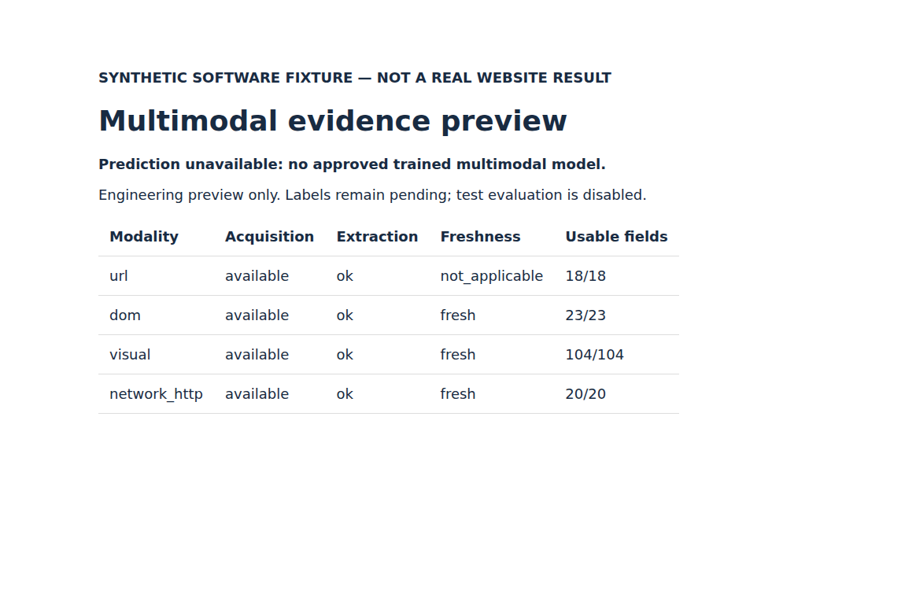

# A03 development follow-up: size, complexity and exposed training components

Completed November 9, 2026. This is a bounded A03 supplement for A04, **not** a new
multimodal-model evaluation. These are post-test-exposure development analyses;
the old test remains consumed and a genuinely independent new test is not yet built.

## Reconstruction and verification

Six immutable PhreshPhish train shards (2,903,636,775 bytes) were downloaded and
verified against the original file sizes/SHA-256 hashes. Frozen sampling and
partition membership were replayed. Only **4,203 development rows** were selected
for HTML-to-Python conversion and feature extraction: 3,461 training and 742
validation. Their source identity, domain and HTML hashes were checked. Extraction
had zero failures and no backfill. Parquet page decoding necessarily includes
neighboring historical test rows at the storage layer; those HTML scalars were not
selected, inspected or converted to features. No new test cohort exists here.

RF and GBDT, each with URL, DOM and URL+DOM, were refitted at the original primary
seed 4941401, threshold 0.5 and fixed parameters. All six original validation
probability vectors matched their archived values **exactly (maximum difference 0)**.
This replay precedes the exclusion comparison; a mismatch aborts the run.

The 12-condition experiment was run locally and in a network-disabled cloud
container. All validation predictions, metrics and bootstrap results match across
environments (only timestamp/runtime metadata differ). Thus 24 fits occurred in
total, but they reproduce one 12-condition experiment; they are not independent
statistical repetitions. A separate verifier recomputes 18 confusion-derived
metrics per condition and ten paired intervals from the retained predictions.

Cloud run: [42716764026](https://github.com/bigbang23155/Hybrid-AI-Based-Phishing-Detection-System-Using-URL-DOM-Visual-and-Network-Traffic-Analysis/actions/runs/42716764026).
Execution source: `5cf439f77d7bea91b492b8980ebaa9c332ac4d29`.
Results: `results/assignment04/sensitivity_v1/` (plan, summary, sanitized validation
predictions, independent verification and execution receipt).

## Joint HTML-size and complexity control

Cuts were chosen by a fixed rule before outcomes were examined: medians of the
original training HTML UTF-8 byte size and DOM tag count. They are **84,436 bytes**
and **475 tags**; equality belongs to the upper bin. Combining two binary cuts
produces four joint strata. Within each class, each stratum receives equal mass;
the two classes receive equal total mass. Weighted confusion totals produce F1.
This does not add HTML size to the original predictor vector or retrain on validation.

| Validation stratum | Benign | Phishing |
|---|---:|---:|
| Smaller HTML, fewer tags | 74 | 207 |
| Smaller HTML, more tags | 29 | 30 |
| Larger HTML, fewer tags | 25 | 46 |
| Larger HTML, more tags | 241 | 90 |

Every stratum contains both classes, so all 742 validation rows remain in the
standardized comparison. Paired whole-group bootstrap resamples the 556 validation
groups 2,000 times, seed 4940411, and re-standardizes each draw. No draw lacked a
required cell. Intervals are descriptive percentile intervals, not multiplicity-
corrected confirmatory tests or estimates of deployment precision.

| Training condition | Model | Standardized URL F1 | Standardized hybrid F1 | Hybrid minus URL | Descriptive 95% interval |
|---|---|---:|---:|---:|---:|
| Original training | RF | 84.27% | 90.26% | +6.00 pp | +2.47 to +9.48 pp |
| Original training | GBDT | 84.95% | 88.67% | +3.73 pp | +0.25 to +7.04 pp |
| Exposed components removed | RF | 81.96% | 88.77% | +6.81 pp | +3.09 to +10.20 pp |
| Exposed components removed | GBDT | 82.31% | 89.96% | +7.65 pp | +3.70 to +11.24 pp |

Both hybrid models retain a benefit under this **coarse joint control**. However,
the earlier tag-quartile-only standardization produced RF +4.16 pp and GBDT +0.41 pp
(the latter interval included zero). The analyses use different partitions and
weights and therefore estimate different standardized populations. The new GBDT
result must not replace or conceal that sensitivity. HTML size and complexity are
not fully controlled within the broad bins; source, language and capture-time
confounding also remain. We have evidence under two explicit controls, not proof
that complexity bias has been eliminated.

## Removing the 464 exposed or related training rows

All 96 linked components were removed together; none overlap validation under the
frozen grouping. Training decreases from 3,461 to **2,997** rows. The removal contains
80 benign and 384 phishing rows, leaving **1,638 benign / 1,359 phishing**. This
changes both training size and class composition, so the contrast does not isolate
an effect of prior exposure. Validation membership, labels, thresholds and model
settings remain identical. There was no new label adoption or parameter search.

| Model | Inputs | Original validation F1 | After removal F1 | Original FPR | After removal FPR |
|---|---|---:|---:|---:|---:|
| RF | URL | 85.13% | 83.77% | 13.01% | 12.47% |
| RF | DOM | 87.99% | 85.99% | 11.38% | 11.38% |
| RF | URL + DOM | 91.28% | 90.08% | 7.05% | 7.05% |
| GBDT | URL | 86.44% | 84.77% | 13.55% | 12.74% |
| GBDT | DOM | 86.59% | 85.48% | 14.63% | 14.36% |
| GBDT | URL + DOM | 90.41% | 91.11% | 7.32% | 5.15% |

For hybrid models, the standardized removal-minus-original F1 change is RF **-1.49 pp**
(interval -3.26 to +0.11) and GBDT **+1.29 pp** (interval -0.24 to +2.73).
Neither interval excludes zero. No universal benefit or harm from removal is established.

RF hybrid training F1 stays 100%, and the ordinary train-validation gap grows from
8.72 to **9.92 pp**. GBDT hybrid training F1 becomes 95.17%, and its gap narrows from
5.10 to **4.06 pp**. Thus exclusion alone does not solve the RF gap. The earlier
training-only assignment is a holdout-exposure precaution, not evidence of unbiased
training or complete campaign independence. Retain the original frozen experiment;
this diagnostic is not a reason to replace its model with the better-looking result.

## Demo verification and next work

Cloud Chromium rendered the synthetic evidence preview at desktop 1150x750 and
mobile 390x844. Automated checks verified five table rows, visible synthetic/no-
prediction disclosures, no external HTTP requests and no document-width overflow.
The downloaded artifact hash was verified, and both screenshots were visually
inspected. Text is legible without overlap; the mobile table is horizontally
scrollable. The demo still has **no trained multimodal prediction**.

Screenshots and receipt are under `results/assignment04/demo_browser_v1/`.
This closes the previous browser-verification gap, not the trained-demo requirement.

A03 supplement work is now sufficient to return priority to A04: synchronize real
human review evidence, obtain aligned screenshot/HTTP pairs, record collection
bias/missingness, establish grouped development and a new independently held-out
cohort, then train simple Visual/HTTP models and compare them on shared validation
samples. No pending human decision is inferred from AI suggestions. The new test
set remains **not established and not evaluated**.
